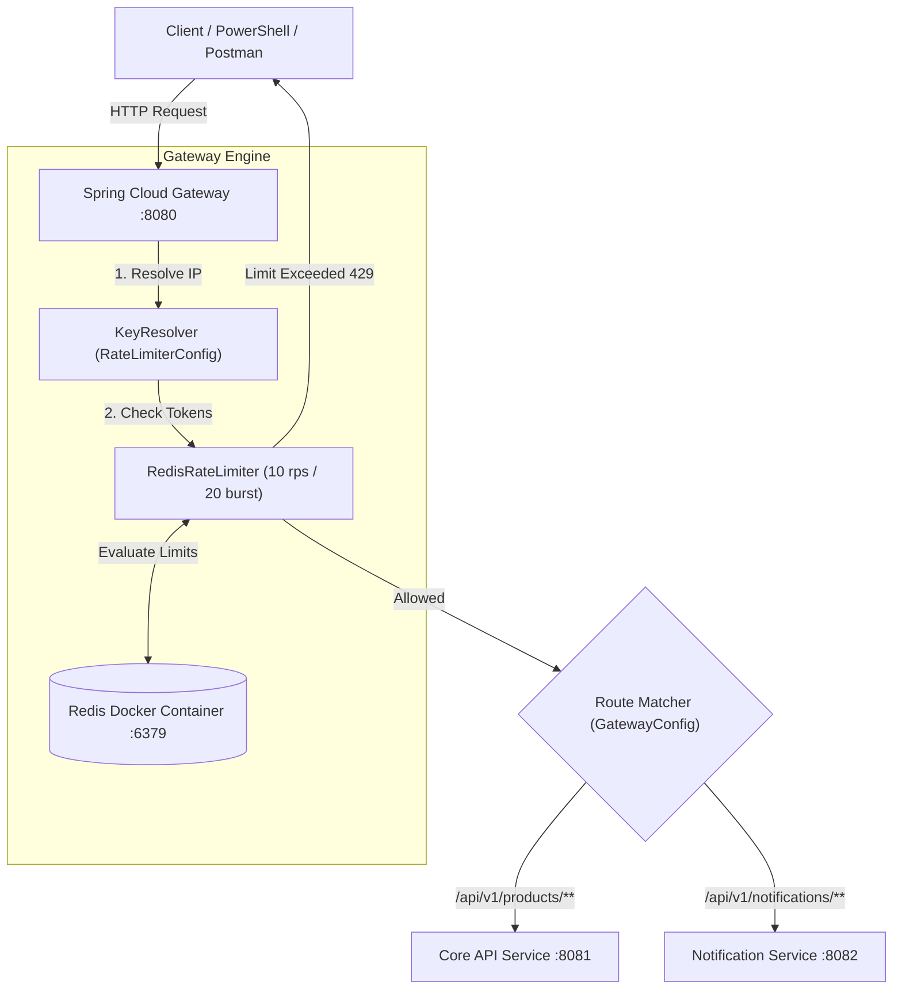
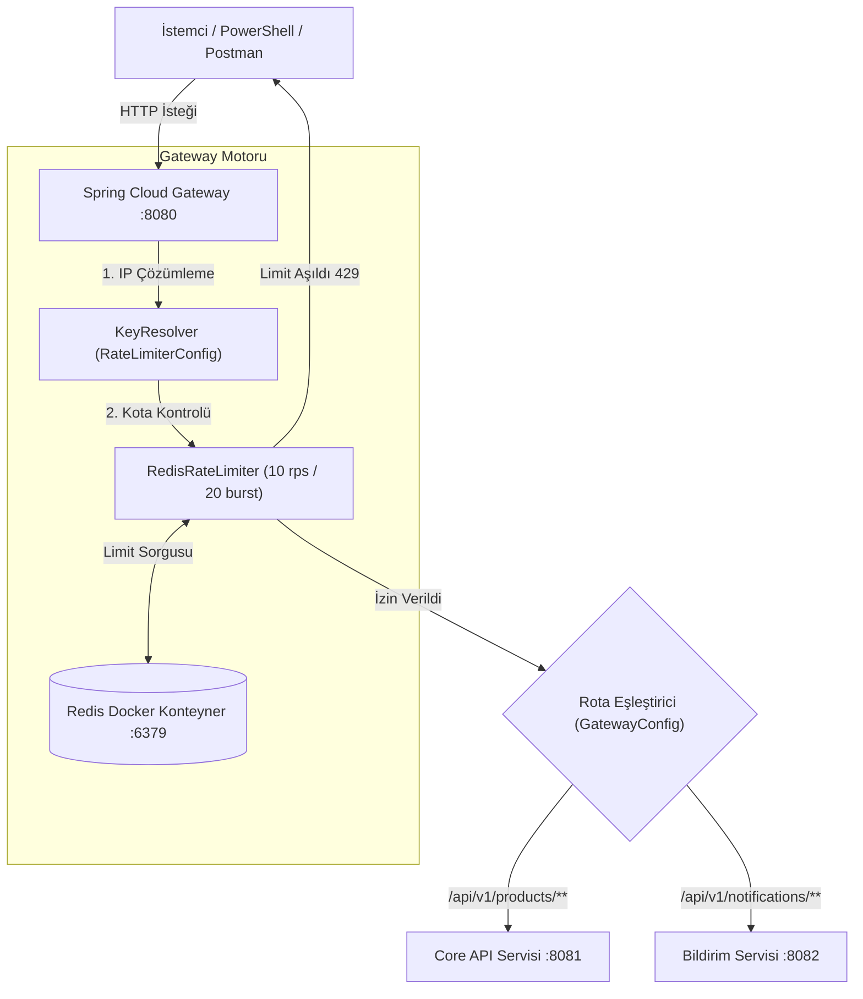

# 🚀 API Gateway Service

[](https://github.com/yusufkayiss/api-gateway/actions)

High-performance, reactive, and resilient API Gateway service for E-Commerce Microservices Architecture built with **Spring Cloud Gateway**, **Java 21**, and **Redis Rate Limiting**.

---

## 🌐 English

### 🚀 Overview
Central Entry Point and Reverse Proxy for the E-Commerce Microservices ecosystem. Designed to handle request routing, client identity resolution, dynamic rate limiting via Redis (Token Bucket Algorithm), and network resilience across distributed backend services.

### 🛠 Tech Stack
- **Language**: Java 21 (LTS)
- **Framework**: Spring Boot 3.x / Spring Cloud Gateway (Reactive WebFlux)
- **Rate Limiting**: Redis (`redis:7-alpine`)
- **Configuration**: Java-based Programmatic Routing (`RouteLocatorBuilder`)
- **Containerization**: Docker
- **Utilities**: Spring Data Reactive Redis

### 📐 Architecture & Request Flow



### ✨ Key Architectural Features
- **Programmatic Java Configuration**: Replaced XML/YAML route declarations with type-safe `RouteLocatorBuilder` to eliminate parser errors and enhance flexibility.
- **Distributed Redis Rate Limiting**: Token Bucket rate limiter preventing DDoS and traffic spikes by limiting requests per IP address.
- **Null-Safe Key Resolver**: Custom IP extraction mechanism fallback logic to ensure continuous gateway operation without `NullPointerExceptions` (`NPE`).
- **Reactive Stack**: Fully non-blocking WebFlux architecture capable of scaling to high concurrent connection counts.

### 🧪 Testing Rate Limits

Execute the following PowerShell script to verify token bucket behavior:

```powershell
1..30 | ForEach-Object { 
    try { 
        (Invoke-WebRequest -Uri "http://localhost:8080/api/v1/products/1" -UseBasicParsing).StatusCode 
    } catch { 
        $_.Exception.Response.StatusCode.Value__ 
    } 
}
```

- **1 to 20 Requests**: Returns `500` (Gateway successfully routes to port 8081; Connection refused when backend service is offline).
- **21+ Requests**: Returns `429 Too Many Requests` (Redis rate limit activated, request rejected immediately at the gateway layer).

---

## 📍 Türkçe

### 🚀 Genel Bakış
E-Ticaret Mikroservis mimarisinin merkezi giriş kapısı ve ters proxy (reverse proxy) servisi. İstemci isteklerinin doğru servislere yönlendirilmesi, IP bazlı kimlik tespiti, Redis ile dinamik istek sınırlaması (Rate Limiting) ve dağıtık ağ yükünün yönetimi için tasarlanmıştır.

### 🛠 Teknolojiler
- **Dil**: Java 21 (LTS)
- **Framework**: Spring Boot 3.x / Spring Cloud Gateway (Reactive WebFlux)
- **İstek Sınırlama (Rate Limiter)**: Redis (`redis:7-alpine`)
- **Konfigürasyon**: Java Tabanlı Programmatik Rotalama (`RouteLocatorBuilder`)
- **Konteynerleştirme**: Docker
- **Veri Erişimi**: Spring Data Reactive Redis

### 📐 Mimari ve İstek Akışı



### ✨ Öne Çıkan Mimari Özellikler
- **Programmatik Java Rotalama**: Tip güvenliği sağlamak ve YAML parser çakışmalarını engellemek amacıyla Java tabanlı `RouteLocatorBuilder` kullanımı.
- **Dağıtık Redis Rate Limiting**: İstemci IP adresi başına istek sınırlandırması yaparak sistemi aşırı yüklenmelerden ve DDoS durumlarından koruyan Token Bucket algoritması.
- **Null-Safe IP Çözümleyici**: `NullPointerExceptions` (`NPE`) riskini ortadan kaldıran esnek IP alma ve fallback mekanizması.
- **Reaktif Yığın (Reactive Stack)**: Yüksek eşzamanlı istek miktarını (concurrency) sorunsuz karşılayan non-blocking WebFlux yapısı.

### 🧪 Rate Limit Test Adımları

Redis Rate Limiter sistemini doğrulamak için aşağıdaki PowerShell komutunu çalıştırabilirsiniz:

```powershell
1..30 | ForEach-Object { 
    try { 
        (Invoke-WebRequest -Uri "http://localhost:8080/api/v1/products/1" -UseBasicParsing).StatusCode 
    } catch { 
        $_.Exception.Response.StatusCode.Value__ 
    } 
}
```

- **1 - 20 Arası İstekler**: `500` döner (Gateway yönlendirmeyi yapar; 8081 portunda servis kapalı olduğu için bağlantı reddedilir).
- **21 ve Üzeri İstekler**: `429 Too Many Requests` döner (Redis kotası dolar, Gateway isteği backend'e iletmeden kapıda engeller).

---

## 💻 Kurulum ve Çalıştırma / Getting Started

1. **Redis Konteynerini Başlatın / Start Redis Container:**
   ```bash
   docker run -d --name ecommerce-redis -p 6379:6379 redis:7-alpine
   ```

2. **API Gateway Servisini Çalıştırın / Run Gateway Application:**
   ```bash
   ./mvnw spring-boot:run
   ```
