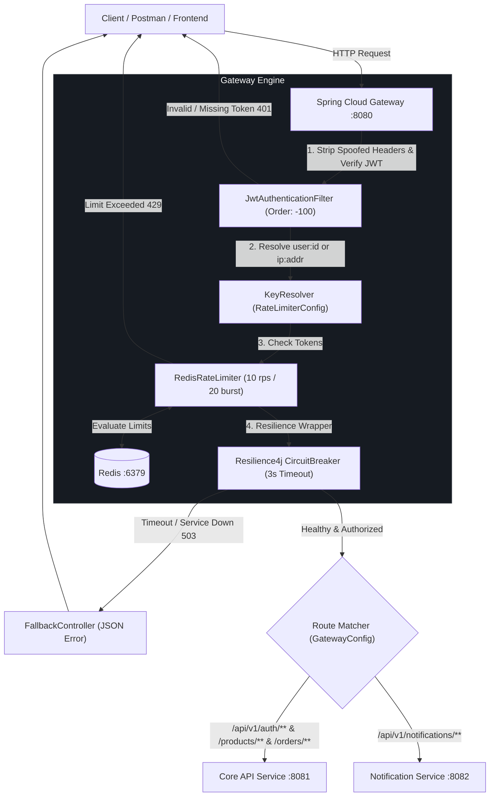
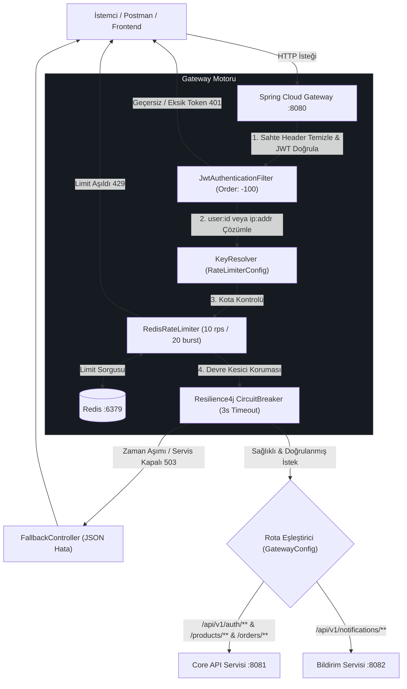

# 🚀 API Gateway Service

[](https://github.com/yusufkayiss/api-gateway/actions)

High-performance, reactive, and resilient API Gateway service for E-Commerce Microservices Architecture built with **Spring Cloud Gateway**, **Java 21**, **Stateless JWT Security**, **Redis Rate Limiting**, and **Resilience4j Circuit Breakers**.

---

## 🌐 English

### 🚀 Overview
Central Entry Point and Reverse Proxy for the E-Commerce Microservices ecosystem. Designed to handle stateless JWT edge authentication, header spoofing protection, hybrid user/IP rate limiting via Reactive Redis (Token Bucket Algorithm), and fault-tolerant routing with graceful fallbacks across distributed backend services.

### 🛠 Tech Stack
- **Language**: Java 21 (LTS)
- **Framework**: Spring Boot 3.4.2 / Spring Cloud Gateway (Reactive WebFlux)
- **Security**: JJWT `0.12.6` (Stateless JWT Validation & `X-User-Id` Propagation)
- **Rate Limiting**: Spring Data Reactive Redis (`redis:7-alpine`, Token Bucket Algorithm)
- **Resilience**: Resilience4j Reactive Circuit Breaker & TimeLimiter
- **Testing**: JUnit 5, `WebTestClient`, WireMock, Testcontainers
- **Containerization & Orchestration**: Docker, Kubernetes (`Deployment`, `Service`, `ConfigMap`)

### 📐 Architecture & Request Flow



### ✨ Key Architectural Features
- **Edge JWT Security & Header Spoofing Protection**: Global reactive filter (`Order = -100`) strips any client-supplied `X-User-Id` header, validates the `Bearer` JWT signature/expiration, and injects the verified `X-User-Id` for downstream services before Redis tokens are consumed.
- **Hybrid Distributed Rate Limiting**: Token Bucket rate limiter (`10 rps` replenish rate, `20` burst capacity) keyed by `user:<userId>` for authenticated traffic (preventing shared NAT/corporate Wi-Fi bottlenecks) and `ip:<clientIp>` for public routes.
- **Circuit Breaker & Graceful Degradation**: Isolates downstream failures via Resilience4j with a `3s` `TimeLimiter`, `50%` failure threshold, and `10s` open-state wait duration, returning clean `503 Service Unavailable` JSON payloads instead of raw `500` errors.
- **Programmatic Java Routing**: Type-safe `RouteLocatorBuilder` configuration with standardized JSON error handling (`GlobalErrorWebExceptionHandler`).
- **Ephemeral Integration Testing**: Automated test suite spinning up real `redis:7-alpine` containers via Testcontainers and stubbing downstream microservices with WireMock.

### 🚦 Routing & Security Matrix

| Path Pattern | HTTP Methods | Access Policy | Downstream Target | Fallback Endpoint |
| :--- | :--- | :--- | :--- | :--- |
| `/api/v1/auth/**` | `ALL` | Public | `core-api` (`:8081`) | `/fallback/core-api` |
| `/api/v1/products/**` | `GET` | Public | `core-api` (`:8081`) | `/fallback/core-api` |
| `/api/v1/products/**` | `POST`, `PUT`, `DELETE` | **JWT Required** | `core-api` (`:8081`) | `/fallback/core-api` |
| `/api/v1/orders/**` | `ALL` | **JWT Required** | `core-api` (`:8081`) | `/fallback/core-api` |
| `/api/v1/notifications/**` | `ALL` | **JWT Required** | `notification-service` (`:8082`) | `/fallback/notifications` |
| `/actuator/**` | `GET` | Public | Gateway Local | — |

### 🧪 Testing Rate Limits & Resilience

Execute the following PowerShell script against a public route to verify Token Bucket & Circuit Breaker behavior:

```powershell
1..30 | ForEach-Object { 
    try { 
        (Invoke-WebRequest -Uri "http://localhost:8080/api/v1/products/1" -UseBasicParsing).StatusCode 
    } catch { 
        $_.Exception.Response.StatusCode.Value__ 
    } 
}
```

- **1 to 20 Requests**: Returns `503 Service Unavailable` via `FallbackController` when `core-api` (`:8081`) is offline (or `200 OK` when online).
- **21+ Requests**: Returns `429 Too Many Requests` (Redis bucket depleted, rejected immediately at the gateway layer).
- **Protected Routes without JWT (`/api/v1/orders`)**: Returns `401 Unauthorized` immediately at `JwtAuthenticationFilter`.

---

## 📍 Türkçe

### 🚀 Genel Bakış
E-Ticaret Mikroservis mimarisinin merkezi giriş kapısı ve ters proxy (reverse proxy) servisi. Stateless JWT kimlik doğrulama, sahte header (Header Spoofing) engelleme, Reactive Redis ile kullanıcı/IP bazlı dinamik istek sınırlama (Rate Limiting) ve Resilience4j Circuit Breaker ile hata toleranslı yönlendirme sağlamak için tasarlanmıştır.

### 🛠 Teknolojiler
- **Dil**: Java 21 (LTS)
- **Framework**: Spring Boot 3.4.2 / Spring Cloud Gateway (Reactive WebFlux)
- **Güvenlik**: JJWT `0.12.6` (Stateless JWT Doğrulama ve `X-User-Id` İletimi)
- **İstek Sınırlama (Rate Limiter)**: Spring Data Reactive Redis (`redis:7-alpine`, Token Bucket Algoritması)
- **Hata Toleransı (Resilience)**: Resilience4j Reactive Circuit Breaker & TimeLimiter
- **Test Altyapısı**: JUnit 5, `WebTestClient`, WireMock, Testcontainers
- **Konteyner ve Orkestrasyon**: Docker, Kubernetes (`Deployment`, `Service`, `ConfigMap`)

### 📐 Mimari ve İstek Akışı



### ✨ Öne Çıkan Mimari Özellikler
- **Merkezi JWT Doğrulama ve Header Spoofing Koruması**: En yüksek öncelikli reaktif filtre (`Order = -100`), dışarıdan gönderilen sahte `X-User-Id` başlıklarını temizler, `Bearer` JWT imzasını doğrular ve iç servislere güvenli `X-User-Id` bilgisini iletir.
- **Hibrit Dağıtık Redis Rate Limiting**: Giriş yapmış kullanıcıları `user:<userId>` anahtarıyla kişiye özel sınırlandırarak ortak ağ (NAT / kurumsal Wi-Fi) çakışmalarını önler; anonim istekleri ise `ip:<ipAdresi>` üzerinden (`10 rps`, `20 burst`) korur.
- **Circuit Breaker ve Graceful Degradation**: Downstream servislerdeki gecikme (`3s` timeout) veya kesintilerde devreyi açarak sistemin kilitlenmesini önler ve istemciye standart `503 Service Unavailable` JSON yanıtı döner.
- **Programmatik Java Rotalama**: Tip güvenliği sağlayan `RouteLocatorBuilder` yapısı ve merkezi JSON hata yönetimi (`GlobalErrorWebExceptionHandler`).
- **Testcontainers Entegrasyon Testleri**: Docker üzerinde izole `redis:7-alpine` konteyneri ve WireMock kullanarak tüm güvenlik, kota ve devre kesici senaryolarını otomatik doğrular.

### 🧪 Rate Limit ve Dayanıklılık Test Adımları

Redis Rate Limiter ve Circuit Breaker davranışını doğrulamak için aşağıdaki PowerShell komutunu çalıştırabilirsiniz:

```powershell
1..30 | ForEach-Object { 
    try { 
        (Invoke-WebRequest -Uri "http://localhost:8080/api/v1/products/1" -UseBasicParsing).StatusCode 
    } catch { 
        $_.Exception.Response.StatusCode.Value__ 
    } 
}
```

- **1 - 20 Arası İstekler**: `core-api` (`:8081`) kapalıysa `FallbackController` devreye girerek `503 Service Unavailable` döner (servis açıksa `200 OK`).
- **21 ve Üzeri İstekler**: `429 Too Many Requests` döner (Redis jeton kovası dolar, Gateway isteği backend'e iletmeden kapıda engeller).
- **Tokensız Korumalı Uç İsteği (`/api/v1/orders`)**: Doğrudan kapıda `401 Unauthorized` döner.

---

## 💻 Kurulum, Test ve Dağıtım / Getting Started

1. **Entegrasyon Testlerini Çalıştırın / Run Integration Tests (Docker Desktop required):**
   ```bash
   ./mvnw test
   ```

2. **Redis Konteynerini Başlatın / Start Redis Container:**
   ```bash
   docker run -d --name ecommerce-redis -p 6379:6379 redis:7-alpine
   ```

3. **API Gateway Servisini Çalıştırın / Run Gateway Application:**
   ```bash
   ./mvnw spring-boot:run
   ```

4. **Kubernetes Üzerine Dağıtım / Deploy to Kubernetes:**
   ```bash
   kubectl apply -f k8s/configmap.yaml
   kubectl apply -f k8s/api-gateway.yaml
   ```
